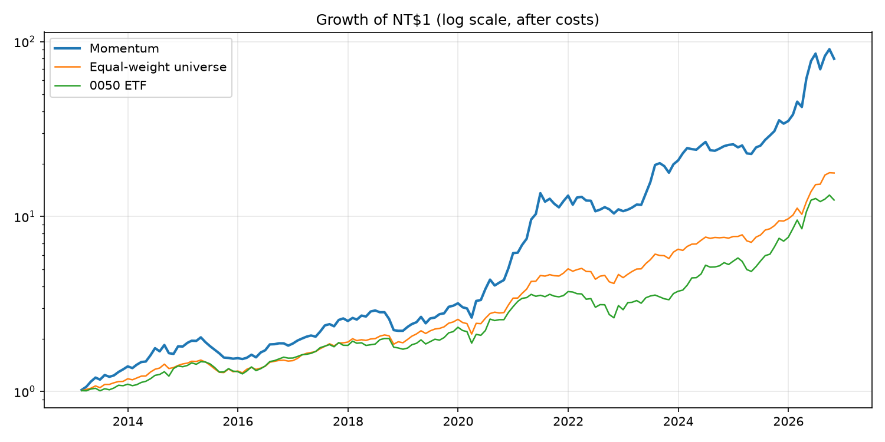
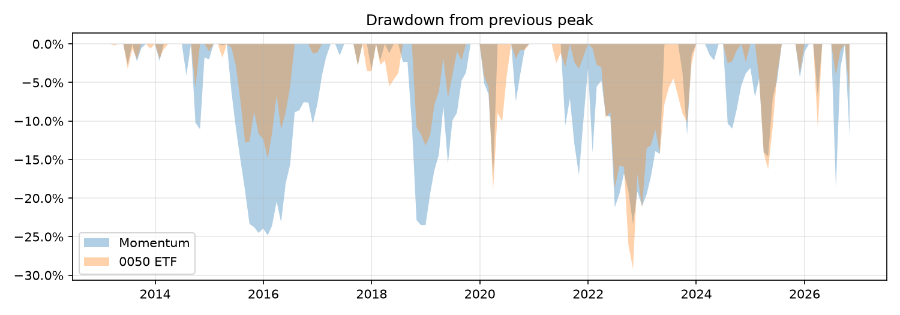
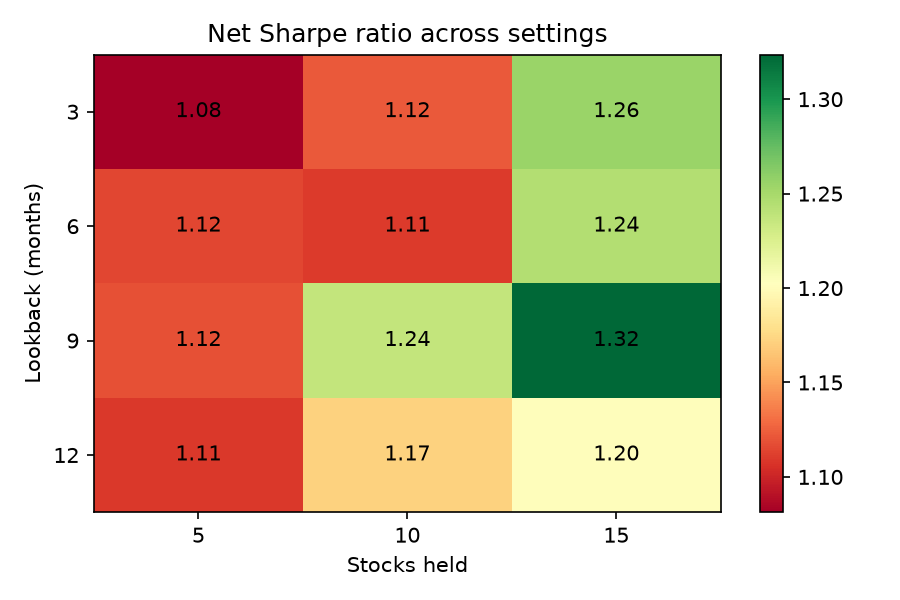

# Taiwan Large-Cap Momentum Backtest

Does buying the recent winners among Taiwan's largest stocks beat simply holding the market?
This project tests a classic **12-1 month cross-sectional momentum** strategy on 50 large
TWSE-listed companies and compares it, **after realistic Taiwan trading costs**, against the
Yuanta Taiwan 50 ETF (0050) and an equal-weight basket of the same stocks.

## Strategy

At the end of each month:

1. **Signal:** for every stock, compute its return from 12 months ago to 1 month ago.
   The latest month is skipped because very recent winners tend to reverse briefly
   (the short-term reversal effect).
2. **Selection:** rank the stocks and buy the top 10, equal weight.
3. **Hold** for one month, then repeat. Stocks with under 12 months of history are excluded.

| Setting | Value |
|---|---|
| Universe | 50 large Taiwan stocks (`config.py`) |
| Period | 2012 onward (first trades in 2013, once 12 months of history exist) |
| Rebalance | Monthly |
| Commission | 0.1425% on buys and sells |
| Securities transaction tax | 0.3% on sells |
| Benchmarks | 0050 ETF; equal-weight universe (same stocks, no ranking) |

The **equal-weight benchmark** matters: it separates the value of the momentum ranking
itself from the value of simply owning these 50 companies.

## Results

<!-- RESULTS:START -->
**Real data, Feb 2013 to Oct 2026, net of trading costs** (165 monthly rebalances)

|                          | Momentum   | Equal-weight universe   | 0050 ETF   |
|:-------------------------|:-----------|:------------------------|:-----------|
| CAGR                     | 37.5%      | 23.3%                   | 20.1%      |
| Volatility               | 29.7%      | 15.4%                   | 18.9%      |
| Sharpe                   | 1.17       | 1.35                    | 0.99       |
| Max drawdown             | -24.8%     | -18.0%                  | -29.2%     |
| Calmar                   | 1.51       | 1.29                    | 0.69       |
| Best month               | 45.3%      | 17.7%                   | 25.1%      |
| Worst month              | -18.6%     | -12.8%                  | -14.1%     |
| Beta vs benchmark        | 1.08       | 0.69                    | -          |
| Alpha (annual)           | 14.5%      | 8.4%                    | -          |
| Tracking error           | 21.7%      | 10.2%                   | -          |
| Information ratio        | 0.74       | 0.20                    | -          |
| Months beating benchmark | 60.0%      | 58.2%                   | -          |
| Annual turnover          | 279.3%     | -                       | -          |

Average trading cost drag: 1.64% per year

**Data checks** (TWSE's 10% daily limit means larger one-day moves are corporate actions or errors):

- 0050.TW 2014-01-02: -75.1% jump matches a 1-for-4 split ratio (price-scale break in source data); earlier prices rescaled
- 1301.TW 2025-08-04: -11.3% one-day move, CHECK MANUALLY
- 2360.TW 2025-08-04: +14.9% one-day move, CHECK MANUALLY
- 2603.TW 2022-09-19: -16.3% one-day move, CHECK MANUALLY
- 2609.TW 2021-04-07: +15.4% one-day move, CHECK MANUALLY
- 3661.TW 2017-10-02: +20.7% one-day move, CHECK MANUALLY





**Robustness check: net Sharpe ratio for other settings**

|   Lookback (months) |    5 |   10 |   15 |
|--------------------:|-----:|-----:|-----:|
|                   3 | 1.08 | 1.12 | 1.26 |
|                   6 | 1.12 | 1.11 | 1.24 |
|                   9 | 1.12 | 1.24 | 1.32 |
|                  12 | 1.11 | 1.17 | 1.2  |


<!-- RESULTS:END -->

## Limitations

These are the honest caveats on the numbers above:

- **Survivorship bias.** The universe is today's large caps. A company that was large in 2013
  and later shrank is missing, while today's winners are included from the start. This
  flatters every strategy that uses the universe, including the equal-weight benchmark.
  The fix is historical index membership, which is not freely available.
- **Data source.** Prices are adjusted closes from Yahoo Finance, which can contain errors.
- **Execution.** Trades are assumed to fill at the month-end close with no market impact.
  That is reasonable for liquid large caps at small size, less so at scale.
- **Costs.** Uses the full statutory commission. Most online brokers give discounts, so real
  costs would be somewhat lower.
- **Overfitting.** The parameter sweep shows how sensitive results are to settings. The headline
  setting (12-1, top 10) is the textbook default from the academic literature, chosen before
  looking at results, not the best cell in the grid.

## How to run

```bash
pip install -r requirements.txt
python run_backtest.py              # downloads prices once, caches to data/prices.csv
python -m pytest                    # checks for look-ahead bias, cost maths, metrics
```

Running the backtest writes charts and tables to `results/` and refreshes the Results section
of this README. Change any setting in `config.py`. `python run_backtest.py --synthetic` runs the
whole pipeline on random data with no internet connection.

## Project structure

```
config.py           universe, dates, strategy and cost settings
run_backtest.py     runs everything and writes the results
src/data.py         downloads and caches prices
src/strategy.py     momentum signal and portfolio weights
src/backtest.py     monthly simulation with drifting weights and trading costs
src/metrics.py      CAGR, Sharpe, drawdown, beta, information ratio
tests/              unit tests, including a look-ahead bias check
```

## Possible extensions

- Volatility-scaled momentum to reduce crash risk
- Sector-neutral ranking, so the portfolio is not just one hot industry
- Historical index membership to remove survivorship bias

## References

- Jegadeesh, N. & Titman, S. (1993). Returns to Buying Winners and Selling Losers.
  *Journal of Finance*, 48(1), 65–91.
